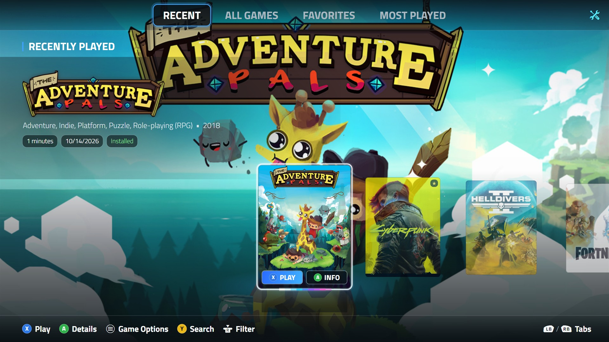
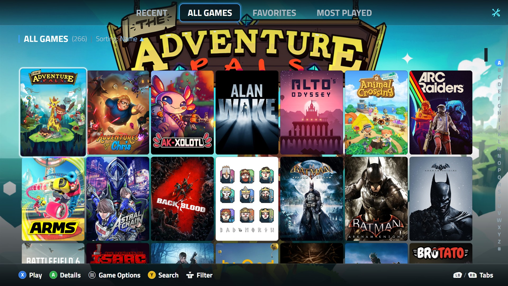
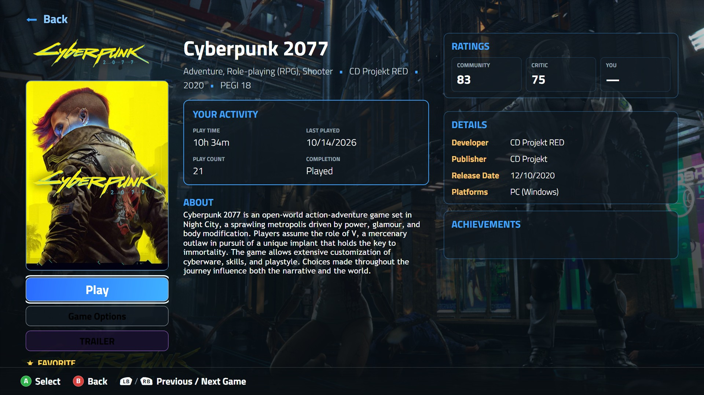

# Handheld Hero

A gamepad-first **Fullscreen theme for [Playnite](https://playnite.link)**, built for 7" 1080p handhelds
and couch setups. Big covers, one-button actions, and nothing that needs a mouse.

## Features

- **Centered carousel** on RECENT / FAVORITES / MOST PLAYED style tabs. The selected cover sits in the middle with
  PLAY and INFO buttons right on it, an animated "Aurora Trace" selection border, a soft floor glow and a reflection.
  Neighbouring covers shrink and dim with distance.
- **Hero block** above the carousel: game logo (or title), genres, year, and pills for playtime, last played,
  installed state and favorite.
- **Library grid** on ALL GAMES with an **A-Z rail** that follows the selected game.
- **Redesigned details screen**: activity, ratings, details, about text, achievements, and a **TRAILER** button
  (no autoplay) that works from a gamepad.
- **Tile badges**: favorite star, PLAYING, and a download arrow for games that are not installed.
- Brighter, more central background art, soft tab and details fade-ins, quieter navigation sounds.
- No pixel-shader effects anywhere, so it stays smooth on low-power hardware and over game streaming.

| All Games | Details |
| --- | --- |
|  |  |

Screenshots are direct captures of Handheld Hero running in Playnite with real games and library artwork.

## Install

1. Download `HandheldHero_1_1_1.pthm` from the [latest release](https://github.com/nickhighland/HandheldHero/releases/latest)
   and double-click it (or drag it onto Playnite), **or** install it from Playnite's add-on browser.
2. In Playnite: **Settings > Appearance > Fullscreen theme** and pick **Handheld Hero**.
3. Restart Playnite in Fullscreen mode.

Tested with Playnite 10.62 (theme API 2.9.0).

## Tabs and layout

The layout is chosen by the **name of the filter preset** shown as a tab. These names get the centered carousel:
`HOME`, `FAVORITES`, `RECENT`, `RECENTLY PLAYED`, `RECENTLY ADDED`, `RECENT GAMES`, `MOST PLAYED`, `TOP PLAYED`,
`CONTINUE PLAYING`. Any other tab (for example `ALL GAMES`) uses the library grid.

## Optional plugins

- [Extra Metadata Loader](https://github.com/darklinkpower/PlayniteExtraMetadataLoader): game logos in the hero
  block and the TRAILER button on the details screen. Without it the game title is shown and the button is hidden.
- [SuccessStory](https://github.com/Lacro59/playnite-successstory-plugin): achievements on the details screen.

## Building from source

`Views/Main.xaml` is the output of a small template generator. The theme files in `HandheldHero/` are the
shipping files; copy that folder into `%APPDATA%\Playnite\Themes\Fullscreen\` to test changes.

## License

MIT. Portions derive from Playnite's default Fullscreen theme (MIT, Josef Nemec).
